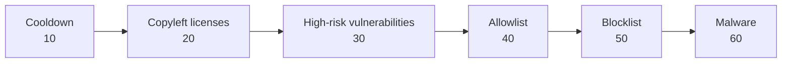

# baseline

Give every workspace the same strong defense in one module. The **baseline** submodule creates the secure baseline recommended by [rego-recipes](https://github.com/cloudsmith-io/rego-recipes): it delays brand-new upstream releases, tags copyleft licenses, quarantines high-risk vulnerabilities and malware, and lets you allowlist or blocklist exact packages.

## The baseline

| Key | Recipe | What it does | Default precedence | Default action |
| --- | ------ | ------------ | ------------------ | -------------- |
| `cooldown` | [`publish_date_cooldown.rego`](https://github.com/cloudsmith-io/rego-recipes/blob/main/recipes/date-time/publish_date_cooldown.rego) | Hides new upstream versions until they reach a minimum age | 10 | Set the state to `HIDDEN` |
| `copyleft_licenses` | [`copyleft_licenses.rego`](https://github.com/cloudsmith-io/rego-recipes/blob/main/recipes/license/copyleft_licenses.rego) | Finds **copyleft** licenses, which require derived work to use the same license | 20 | Add the tag `copyleft-license` |
| `high_risk_vulnerabilities` | [`cvss_with_fix.rego`](https://github.com/cloudsmith-io/rego-recipes/blob/main/recipes/vulnerability/cvss_with_fix.rego) | Finds vulnerabilities with a high **CVSS** score (Common Vulnerability Scoring System) that have a fix | 30 | Set the state to `QUARANTINED` |
| `allowlist` | [`allowlist.rego`](https://github.com/cloudsmith-io/rego-recipes/blob/main/recipes/format-name-version/allowlist.rego) | Approves exact package versions | 40 | Set the state to `AVAILABLE` |
| `blocklist` | [`blocklist.rego`](https://github.com/cloudsmith-io/rego-recipes/blob/main/recipes/format-name-version/blocklist.rego) | Blocks packages or exact versions | 50 | Set the state to `QUARANTINED` |
| `malware` | [`malware.rego`](https://github.com/cloudsmith-io/rego-recipes/blob/main/recipes/vulnerability/malware.rego) | Finds known malicious packages | 60 | Set the state to `QUARANTINED` |

The module creates all the policies by default. To leave a policy out, set its variable to `null`. The module creates the allowlist and blocklist policies only when you give entries.

## Why the order matters

Cloudsmith evaluates the policies from the lowest precedence to the highest, and **the last matched state wins**. The default order gives you the result you expect:



- The **allowlist** makes an approved package available again after the vulnerability policy quarantines it.
- The **blocklist** and **malware** policies come last, so nothing can make a blocked or malicious package available.

## Usage

```hcl
module "policy_baseline" {
  source  = "cloudsmith-io/policy/cloudsmith//modules/baseline"
  version = "~> 0.1"

  workspace = "my-workspace"

  cooldown = {
    within_past_days  = 7
    supported_formats = ["npm", "python"]
  }

  allowlist = { entries = ["python:example-lib:1.2.3"] }
  blocklist = { entries = ["npm:compromised-ui"] }
}
```

**Tip:** Set `enabled = false` for the first apply. You can then examine the policies in the web app before they affect any package.

## Tune a recipe

Each recipe has variables, such as `within_past_days` in the cooldown recipe. Set an attribute to change the variable. Leave it `null` to keep the value from the recipe. The module changes only the variables that you set, and takes the policy name and description from the METADATA block of the recipe.

## Recipe downloads

- Terraform downloads the recipes with the [http provider](https://registry.terraform.io/providers/hashicorp/http/latest) during each plan.
- Set `recipes_ref` to a **commit SHA**. A branch or a tag can change without a change to your configuration.
- Set `recipes_url` to use a mirror of the repository. The module adds `/<recipes_ref>/recipes/<path>` to the URL.
- The plan stops if a download fails, or if a recipe does not define a variable that you set.

## Cooldown policy

> A cooldown gives the security community time to find a malicious release before your builds can download it.

The [cooldown policy](https://docs.cloudsmith.com/supply-chain-security/policy-as-code/cooldown-policy) hides new versions of upstream packages from the repository index until they reach the minimum age. If a client asks for a hidden version, Cloudsmith returns HTTP 403 with the policy name and description. Set `cooldown.description` to tell your developers what to do next, for example who to ask for an exemption.

### Rules from Cloudsmith

- After Cloudsmith creates the policy, you can change only the name, the description, the enabled state, and the values of the cooldown variables: `within_past_days`, `supported_formats`, `included_repositories`, `excluded_repositories` and `include_local_packages`.
- The policy must be **terminal**.
- A workspace can have only one cooldown policy.
- A cooldown policy without a `HIDDEN` action matches packages, but does not hide them.
- The cooldown applies only to packages that have an upstream publish date.
- Clients can see the old index for a short time after a change, because of caching. Changes can take some minutes to reach cached packages.

### Checks in the module

- `supported_formats` must contain one or more of the supported formats: `cargo`, `conda`, `docker`, `go`, `maven`, `npm`, `nuget` and `python`. An empty set matches no packages.
- `within_past_days` must be a whole number of 1 or more.
- After the apply, Cloudsmith must report the policy as a cooldown policy (`read_only = true`). If not, the apply stops.

### Move to a new recipe commit

If a new `recipes_ref` changes the cooldown recipe in more than its variables, Cloudsmith rejects the update. Replace the policy:

```sh
terraform apply -replace='module.policy_baseline.module.policy["cooldown"].cloudsmith_policy.this'
```

### Import a cooldown policy from the web app

When you create a cooldown policy from the web app template, Cloudsmith also creates its `HIDDEN` action. Import both before the first apply. If you do not, the apply stops, because a workspace can have only one cooldown policy.

```hcl
import {
  to = module.policy_baseline.module.policy["cooldown"].cloudsmith_policy.this
  id = "<workspace>.<policy_slug_perm>"
}

import {
  to = module.policy_baseline.module.policy["cooldown"].cloudsmith_policy_action.this["hide"]
  id = "<workspace>.<policy_slug_perm>.<action_slug_perm>"
}
```

Set `cooldown.name` and `cooldown.description` to the values in the web app, or Terraform changes them.

<!-- BEGIN_TF_DOCS -->
## Requirements

| Name | Version |
| ---- | ------- |
| terraform | >= 1.3 |
| cloudsmith | >= 0.0.81 |
| http | >= 3.4 |

## Providers

| Name | Version |
| ---- | ------- |
| http | >= 3.4 |

## Modules

| Name | Source | Version |
| ---- | ------ | ------- |
| policy | ../../ | n/a |

## Resources

| Name | Type |
| ---- | ---- |
| [http_http.recipe](https://registry.terraform.io/providers/hashicorp/http/latest/docs/data-sources/http) | data source |

## Inputs

| Name | Description | Type | Default | Required |
| ---- | ----------- | ---- | ------- | :------: |
| workspace | The slug of the Cloudsmith workspace that owns the policies. | `string` | n/a | yes |
| allowlist | The allowlist policy matches packages in `entries`, in the format `format:name:version`.<br/>The default action makes the packages available again, after the policies with a lower precedence quarantine them.<br/>The module creates the policy only when `entries` is not empty. | <pre>object({<br/>    entries     = optional(set(string), [])<br/>    precedence  = optional(number, 40)<br/>    name        = optional(string)<br/>    description = optional(string)<br/>    enabled     = optional(bool)<br/>    actions = optional(map(object({<br/>      set_package_state   = optional(string)<br/>      add_package_tags    = optional(set(string))<br/>      remove_package_tags = optional(set(string))<br/>      precedence          = optional(number)<br/>    })), { allow = { set_package_state = "AVAILABLE" } })<br/>  })</pre> | `{}` | no |
| blocklist | The blocklist policy matches packages in `entries`, in the format `format:name` or `format:name:version`.<br/>The module creates the policy only when `entries` is not empty. | <pre>object({<br/>    entries     = optional(set(string), [])<br/>    precedence  = optional(number, 50)<br/>    name        = optional(string)<br/>    description = optional(string)<br/>    enabled     = optional(bool)<br/>    actions = optional(map(object({<br/>      set_package_state   = optional(string)<br/>      add_package_tags    = optional(set(string))<br/>      remove_package_tags = optional(set(string))<br/>      precedence          = optional(number)<br/>    })), { quarantine = { set_package_state = "QUARANTINED" } })<br/>  })</pre> | `{}` | no |
| cooldown | The cooldown policy hides new upstream package versions from the repository index until they reach a minimum age.<br/>A null attribute keeps the value in the recipe. Set the variable to null to not create the policy.<br/>A workspace can have only one cooldown policy. | <pre>object({<br/>    within_past_days       = optional(number)<br/>    supported_formats      = optional(set(string))<br/>    included_repositories  = optional(set(string))<br/>    excluded_repositories  = optional(set(string))<br/>    include_local_packages = optional(bool)<br/>    precedence             = optional(number, 10)<br/>    name                   = optional(string)<br/>    description            = optional(string)<br/>    enabled                = optional(bool)<br/>    actions = optional(map(object({<br/>      set_package_state   = optional(string)<br/>      add_package_tags    = optional(set(string))<br/>      remove_package_tags = optional(set(string))<br/>      precedence          = optional(number)<br/>    })), { hide = { set_package_state = "HIDDEN" } })<br/>  })</pre> | `{}` | no |
| copyleft\_licenses | The copyleft license policy matches packages whose declared license, or any SBOM component license, is in `licenses`.<br/>A null attribute keeps the value in the recipe. Set the variable to null to not create the policy. | <pre>object({<br/>    licenses    = optional(set(string))<br/>    precedence  = optional(number, 20)<br/>    name        = optional(string)<br/>    description = optional(string)<br/>    enabled     = optional(bool)<br/>    actions = optional(map(object({<br/>      set_package_state   = optional(string)<br/>      add_package_tags    = optional(set(string))<br/>      remove_package_tags = optional(set(string))<br/>      precedence          = optional(number)<br/>    })), { tag = { add_package_tags = ["copyleft-license"] } })<br/>  })</pre> | `{}` | no |
| enabled | Set to true to evaluate the policies. Cloudsmith evaluates packages again when a policy is created or changed. | `bool` | `true` | no |
| high\_risk\_vulnerabilities | The high-risk vulnerability policy matches packages with a fixable vulnerability at or above `cvss_threshold`.<br/>The policy ignores the vulnerability IDs and aliases in `ignored_ids`.<br/>A null attribute keeps the value in the recipe. Set the variable to null to not create the policy. | <pre>object({<br/>    cvss_threshold = optional(number)<br/>    ignored_ids    = optional(set(string))<br/>    precedence     = optional(number, 30)<br/>    name           = optional(string)<br/>    description    = optional(string)<br/>    enabled        = optional(bool)<br/>    actions = optional(map(object({<br/>      set_package_state   = optional(string)<br/>      add_package_tags    = optional(set(string))<br/>      remove_package_tags = optional(set(string))<br/>      precedence          = optional(number)<br/>    })), { quarantine = { set_package_state = "QUARANTINED" } })<br/>  })</pre> | `{}` | no |
| malware | The malware policy matches packages with a MAL- vulnerability ID or the CWE-506 weakness. Set to null to not create the policy. | <pre>object({<br/>    precedence  = optional(number, 60)<br/>    name        = optional(string)<br/>    description = optional(string)<br/>    enabled     = optional(bool)<br/>    actions = optional(map(object({<br/>      set_package_state   = optional(string)<br/>      add_package_tags    = optional(set(string))<br/>      remove_package_tags = optional(set(string))<br/>      precedence          = optional(number)<br/>    })), { quarantine = { set_package_state = "QUARANTINED" } })<br/>  })</pre> | `{}` | no |
| name\_prefix | A prefix for the name of each policy. Policy names must be unique in a workspace. | `string` | `""` | no |
| recipes\_ref | The rego-recipes commit to download the Rego from. Use a commit SHA, because a branch or tag can change. | `string` | `"fb6e34c937267ba07712ef32a9d216b1ca1ccd38"` | no |
| recipes\_url | The base URL to download the rego-recipes repository files from. Change it to use a mirror. | `string` | `"https://raw.githubusercontent.com/cloudsmith-io/rego-recipes"` | no |

## Outputs

| Name | Description |
| ---- | ----------- |
| policies | The created policies, keyed by recipe name. |
| rego | The rendered Rego source of each created policy, keyed by recipe name. |
<!-- END_TF_DOCS -->
